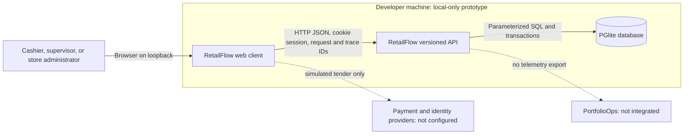
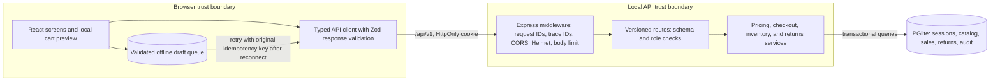
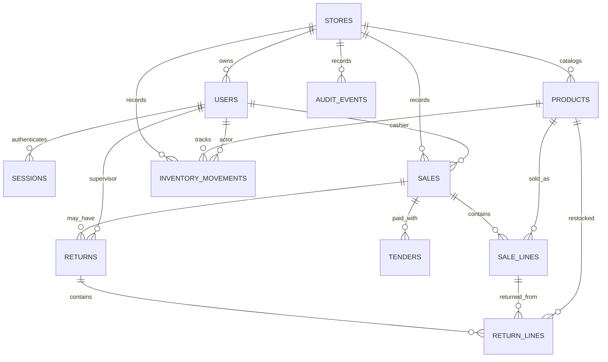
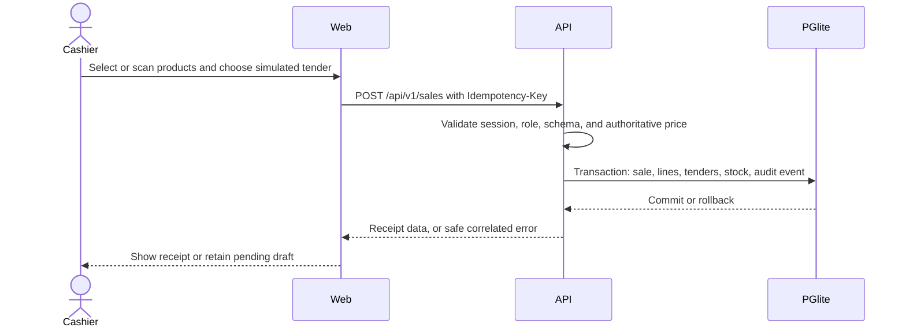

# RetailFlow Architecture

This document describes the implemented local RetailFlow prototype. The backend
repository is the source of truth for the API, persistence model, and system
boundaries. It is not a production deployment design.

The [data-mode guide](../../DATA_MODE_AND_ARCHITECTURE.md) documents build-time
mock/live endpoint selection and isolated E2E commands for both modes.

## Runtime Boundaries

| Container     | Implementation                                 | Responsibility                                                                              |
| ------------- | ---------------------------------------------- | ------------------------------------------------------------------------------------------- |
| Web client    | React 19, TypeScript, Vite at `127.0.0.1:5001` | Cashier and manager workflows, local cart preview, typed API client, pending offline drafts |
| API           | Express 5, TypeScript at `127.0.0.1:5002`      | Authentication, role checks, validation, authoritative pricing, stock and sale transactions |
| Database      | PGlite at `.local/postgres`                    | Local PostgreSQL-compatible persistence and migrations                                      |
| Browser queue | Schema-validated `localStorage`                | Offline checkout drafts; a draft is not a completed sale until the API accepts it           |

Payments are simulated as cash or sandbox tenders. Identity is synthetic and
local. There is no external payment processor, identity provider, Redis service,
PortfolioOps collector, message broker, or public deployment. The local-stack
decision and its consequences are recorded in
[`docs/adr/0001-local-web-and-pglite.md`](adr/0001-local-web-and-pglite.md).

## C4 Context



## C4 Containers and Data Flow



The browser is untrusted. It may preview totals but cannot set authoritative
prices, roles, stock, or persisted sale totals. The API resolves the session,
checks permissions, validates request bodies, recalculates prices, and commits
sale, tender, stock, return, and audit changes transactionally. Local HTTP is
used only because both services bind to loopback; a deployed environment needs
TLS and an explicit production configuration.

Every API request receives an `X-Request-ID` and trace ID. The client sends
W3C `traceparent`; the API returns `X-Trace-ID` and correlates safe error
envelopes and structured logs. Cookie and authorization headers are redacted.
No browser analytics or PortfolioOps events are currently emitted.

## Data Ownership

The initial schema is defined in
[`src/db/migrations/001_initial.sql`](../src/db/migrations/001_initial.sql).
Money is stored as integer USD minor units. Prices, role assignments, inventory,
sale state, refunds, and audit events are server-owned.



## Primary Workflows

### Checkout

Precondition: a synthetic cashier or elevated store role has a valid local
session, and the catalog is available. The UI builds a cart and preview; the
API recalculates the total from stored prices and demo tax settings.



If the API is unavailable, the browser stores a schema-validated draft with its
original idempotency key. It is visibly pending and is only considered complete
after a successful API response. Retry and storage failure are surfaced in the
UI; local queue data is not authoritative.

### Return

Precondition: the user is a supervisor or store administrator and the sale is
visible to that user's store. The API locks the sale row, verifies remaining
returnable quantities, computes the refund from the original sale lines, and
commits return lines, stock restoration, sale status, and audit event together.
An over-return is rejected with `409 RETURN_QUANTITY_EXCEEDED`; idempotency and
transaction serialization prevent a concurrent duplicate from restoring stock
twice.

### Inventory and Settings

Supervisors and store administrators may adjust stock; the API rejects a
negative resulting quantity. Only store administrators may update the demo tax
rate. Both operations are server-authorized and audited. Cashiers may inspect
the views but do not receive elevated write access.

## Implemented Design Patterns and Invariants

- **Layered API:** Express middleware establishes request/security context; versioned routes validate request and role; domain services own pricing, checkout, inventory, and returns; database helpers own parameterized PGlite queries and transactions.
- **Server-authoritative commands:** the browser may preview a basket, but the API recalculates prices/tax, validates inventory and role, and persists the resulting sale/return. DTOs are the client contract; UI state is not trusted.
- **Transactional state changes:** checkout, returns, inventory adjustments, and audit records commit or roll back together. Return quantities derive from original sale lines; stock cannot become negative.
- **Idempotent recovery:** checkout/return retries use stable idempotency keys. Offline cash drafts are validated browser-local intents, never completed sales until acknowledged by the API.
- **Session boundary:** synthetic role sessions are server-issued and local-only; authorization is enforced per request. Role discovery/login is disabled in production, and no external identity provider is configured.

Failure paths are part of the workflows above: stale/invalid input and denied roles do not persist a sale; a transaction failure rolls back linked records; a stock/return conflict leaves the sale and inventory unchanged; API outages keep offline cash drafts pending for retry with the original idempotency key.

## API and Deployment

`openapi.json` is the OpenAPI 3.1 contract. `/api/v1` is the supported route
prefix; `/api` is mounted only outside production for local compatibility. The
frontend and backend are independent repositories and communicate only through
the versioned HTTP contract. They do not share a database.

Local startup uses the two `npm run dev` commands documented in each README.
The PGlite file database is for synthetic local workflows only. Any external
deployment requires a reviewed PostgreSQL provider, least-privilege roles,
TLS, backup/restore and migration procedures, auth configuration, retention,
monitoring, and a deployment ADR. Shift close, mobile scanning, a shared
telemetry collector, and production identity/payment integrations are not
implemented.

## Local Verification and Coverage

Run checks separately in each repository. Vitest enforces 90% aggregate coverage
for statements, branches, functions, and lines, plus 95% on the critical
frontend money preview and backend pricing, refund, checkout, inventory API,
and session-auth modules:

```sh
cd retailflow-frontend
npm run format:check
npm run lint
npm test -- --coverage
npm run test:e2e
VITE_IS_MOCK=false npm run test:e2e
npm run build
npm audit

cd ../retailflow-backend
npm run format:check
npm run lint
npm test -- --coverage
npm run typecheck
npm run validate:openapi
npm run build
npm audit
```

The latest local run passed 71 frontend tests across 16 files and 47 backend
tests across 9 files. Frontend aggregate coverage was 93.56% statements, 90.70%
branches, 92.12% functions, and 95.01% lines. Backend aggregate coverage was
98.99% statements, 95.30% branches, 97.36% functions, and 99.14% lines.
Pricing, refund, checkout/return transaction, inventory API, and server-session
critical paths reached 100% branch coverage in the latest backend report. The
frontend and backend test runners enforce the per-file critical thresholds.
Some noncritical orchestration and infrastructure files remain below 90% in
individual categories; the aggregate application gates pass.

Playwright is browser workflow coverage, not source-code coverage. Its two
workflows passed in mock mode and live-selection mode; each run uses isolated
ports and in-memory PGlite. The live-selection run verifies API routing only,
not hosted PostgreSQL or production identity.

Performance budgets/Core Web Vitals, a full WCAG 2.2 AA audit, secret scanning
of Git history, and production database/auth integrations have not been
verified. The current API is local-only and uses synthetic records.
