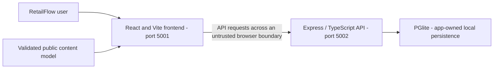
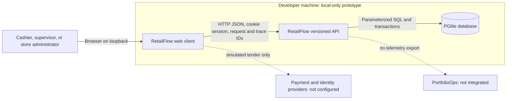
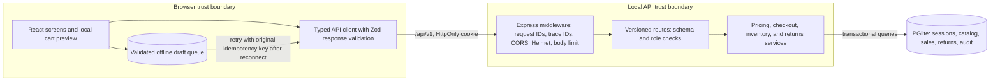
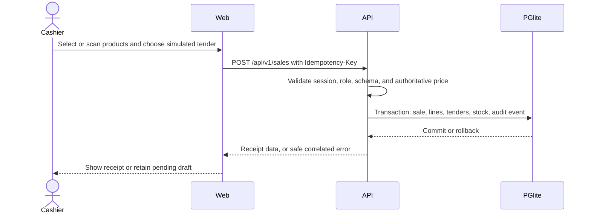
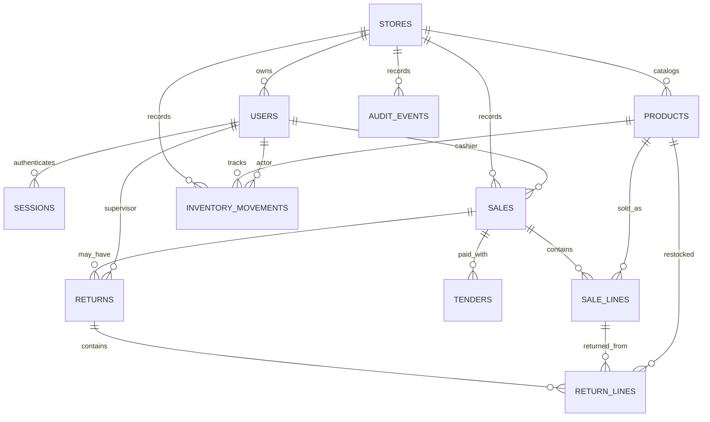

# RetailFlow Backend Architecture

Maintained in this independent Git repository at **docs/architecture.md**. Updated **2026-11-09**. The guide covers the implemented stack, interfaces, data model, operational limits, and release requirements.

## Contents

1. [Scope, users, and repository boundary](#1-scope-users-and-repository-boundary)
2. [Context, containers, and trust boundaries](#2-context-containers-and-trust-boundaries)
3. [Source ownership and module map](#3-source-ownership-and-module-map)
4. [Screens, navigation, and lifecycle](#4-screens-navigation-and-lifecycle)
5. [Primary workflows and recovery](#5-primary-workflows-and-recovery)
6. [Domain, persistence, and data ownership](#6-domain-persistence-and-data-ownership)
7. [API and internal contracts](#7-api-and-internal-contracts)
8. [Security, privacy, and egress](#8-security-privacy-and-egress)
9. [Design, accessibility, and platform adapters](#9-design-accessibility-and-platform-adapters)
10. [Build, checks, and deployment](#10-build-checks-and-deployment)
11. [Architecture decisions and tradeoffs](#11-architecture-decisions-and-tradeoffs)
12. [Requirements traceability](#12-requirements-traceability)
13. [Dated verification and limitations](#13-dated-verification-and-limitations)
14. [Extension rules and companion repository](#14-extension-rules-and-companion-repository)

## 1. Scope, users, and repository boundary

Assisted checkout and store operations for cashiers, supervisors, and store administrators.

Catalog and barcode lookup, basket pricing, simulated split tenders, receipts, partial returns, stock adjustments, and pending cash drafts.

This repository owns the Express / TypeScript API and PGlite state. UI rendering belongs to the separate frontend. The service validates and executes the domain operations described below.

There are two independent Git roots for this application, each with its own README and architecture guide. A parent app/workspace folder is a checkout convenience. Use synthetic records; current local services remain on loopback.

### Runtime Boundaries

| Container     | Implementation                                 | Responsibility                                                                              |
| ------------- | ---------------------------------------------- | ------------------------------------------------------------------------------------------- |
| Web client    | React 19, TypeScript, Vite at `127.0.0.1:5001` | Cashier and manager workflows, local cart preview, typed API client, pending offline drafts |
| API           | Express 5, TypeScript at `127.0.0.1:5002`      | Authentication, role checks, validation, authoritative pricing, stock and sale transactions |
| Database      | PGlite at `.local/postgres`                    | Local PostgreSQL-compatible persistence and migrations                                      |
| Browser queue | Schema-validated `localStorage`                | Offline checkout drafts; a draft is not a completed sale until the API accepts it           |

Payments are simulated as cash or sandbox tenders. Identity is synthetic and
local. There is no external payment processor, identity provider, Redis service,
PortfolioOps collector, message broker, or public deployment. The local-stack
decision and its consequences are recorded in
[`docs/adr/0001-local-web-and-pglite.md`](adr/0001-local-web-and-pglite.md).

## 2. Context, containers, and trust boundaries



The API is the data authority, but only the identity/ownership controls actually implemented below can be relied on. CORS is not authentication.

### C4 Context



### C4 Containers and Data Flow



The browser is untrusted. It may preview totals but cannot set authoritative
prices, roles, stock, or persisted sale totals. The API resolves the session,
checks permissions, validates request bodies, recalculates prices, and commits
sale, tender, stock, return, and audit changes transactionally. Local HTTP is
used only because both services bind to loopback; a deployed environment needs
TLS and an explicit production configuration.

Every API request receives an `X-Request-ID` and trace ID. The client sends
W3C `traceparent`; the API returns `X-Trace-ID` and correlates safe error
envelopes and structured logs. Cookie and authorization headers are redacted.
No browser analytics or PortfolioOps events are currently emitted.

## 3. Source ownership and module map

| Owner/path                                                                                                                                 | Responsibility                                                               |
| ------------------------------------------------------------------------------------------------------------------------------------------ | ---------------------------------------------------------------------------- |
| [src/app.ts](../src/app.ts)<br>[src/server.ts](../src/server.ts)                                                                           | Process bootstrap, HTTP composition, and configuration                       |
| [src/services/returns-service.ts](../src/services/returns-service.ts)<br>[src/services/sales-service.ts](../src/services/sales-service.ts) | Application workflow/state-machine owners                                    |
| [src/db/database.ts](../src/db/database.ts)                                                                                                | Storage/transaction owners; memory where implemented                         |
| [src/db/migrations/001_initial.sql](../src/db/migrations/001_initial.sql)<br>[src/sales-schema.ts](../src/sales-schema.ts)                 | Validation/schema and migration authority                                    |
| [src/http/auth.ts](../src/http/auth.ts)                                                                                                    | Existing session/role/limiter modules; their presence is not a hosting claim |
| [src/http/api-error.ts](../src/http/api-error.ts)                                                                                          | Safe errors, origin handling, or request correlation as implemented          |
| [openapi.json](../openapi.json)                                                                                                            | Published request/response contract source                                   |
| [.github/workflows](../.github/workflows)                                                                                                  | Configured CI; hosted outcomes require separate verification                 |
| [src/app.edge.test.ts](../src/app.edge.test.ts)<br>[src/app.test.ts](../src/app.test.ts)                                                   | Examples of existing colocated tests                                         |

The source map follows the existing framework directories and test placement.

## 4. Screens, navigation, and lifecycle

This repository has no rendered screens. It supports the frontend through the HTTP/domain contracts in sections 5–7. Its lifecycle entry, response/error mapping, session behavior where present, and storage ownership are listed in section 3. Startup health is http://127.0.0.1:5002/health; that configured address is not evidence of a running service. Persistent state is owned by this backend; preserve existing database files during changes.

## 5. Primary workflows and recovery

### Primary Workflows

#### Checkout

Precondition: a synthetic cashier or elevated store role has a valid local
session, and the catalog is available. The UI builds a cart and preview; the
API recalculates the total from stored prices and demo tax settings.



If the API is unavailable, the browser stores a schema-validated draft with its
original idempotency key. It is visibly pending and is only considered complete
after a successful API response. Retry and storage failure are surfaced in the
UI; local queue data is not authoritative.

#### Return

Precondition: the user is a supervisor or store administrator and the sale is
visible to that user's store. The API locks the sale row, verifies remaining
returnable quantities, computes the refund from the original sale lines, and
commits return lines, stock restoration, sale status, and audit event together.
An over-return is rejected with `409 RETURN_QUANTITY_EXCEEDED`; idempotency and
transaction serialization prevent a concurrent duplicate from restoring stock
twice.

#### Inventory and Settings

Supervisors and store administrators may adjust stock; the API rejects a
negative resulting quantity. Only store administrators may update the demo tax
rate. Both operations are server-authorized and audited. Cashiers may inspect
the views but do not receive elevated write access.

## 6. Domain, persistence, and data ownership

The API owns the current persistence boundary. Keep database engines, schema/migration order, exact-money rules where applicable, and transaction invariants consistent with executable source.

### Data Ownership

The initial schema is defined in
[`src/db/migrations/001_initial.sql`](../src/db/migrations/001_initial.sql).
Money is stored as integer USD minor units. Prices, role assignments, inventory,
sale state, refunds, and audit events are server-owned.



## 7. API and internal contracts

The repository contract is [openapi.json](../openapi.json). Keep public paths, status/error envelopes, headers, payload validation, and compatibility tied to that source.

### API and Deployment

`openapi.json` is the OpenAPI 3.1 contract. `/api/v1` is the supported route
prefix; `/api` is mounted only outside production for local compatibility. The
frontend and backend are independent repositories and communicate only through
the versioned HTTP contract. They do not share a database.

Local startup uses the two `npm run dev` commands documented in each README.
The PGlite file database is for synthetic local workflows only. Any external
deployment requires a reviewed PostgreSQL provider, least-privilege roles,
TLS, backup/restore and migration procedures, auth configuration, retention,
monitoring, and a deployment ADR. Shift close, mobile scanning, a shared
telemetry collector, and production identity/payment integrations are not
implemented.

## 8. Security, privacy, and egress

Current release limitation: **Demo-role login is disabled by NODE_ENV=production. Production identity, store isolation, recovery, and hosting remain open. The baseline has formatting and Windows path-test failures.**

Only the local simulator controls in the current source are implemented. CORS, a role label, and mode selection do not provide a new production identity boundary.

Keep private credentials out of public models, browser bundles, logs, URLs, and source archives. No additional runtime network destination or external service is configured. Keep logs limited to the source-defined request/trace and safe aggregate fields. Backups, retention, deletion, and real-user ownership need explicit product/operations decisions before external exposure.

## 9. Design, accessibility, and platform adapters

There is no visual rendering or native package in this API repository. Preserve safe errors and stable contracts so the frontend can present accessible recovery states. Hardware scanning, banking/payment rails, shipping providers, and native integrations remain limited to what the current source actually implements; simulator behavior is not device/provider integration.

## 10. Build, checks, and deployment

Configured npm scripts, from this repository with Node **24.15.0**; use `npm.cmd` in PowerShell:

| Command                        | Actual manifest definition                                                                                                |
| ------------------------------ | ------------------------------------------------------------------------------------------------------------------------- |
| `npm.cmd run dev`              | `tsx watch src/server.ts`                                                                                                 |
| `npm.cmd run build`            | `node scripts/clean-dist.mjs && tsc -p tsconfig.build.json && node scripts/copy-migrations.mjs`                           |
| `npm.cmd run start`            | `node dist/server.js`                                                                                                     |
| `npm.cmd run test`             | `vitest run`                                                                                                              |
| `npm.cmd run typecheck`        | `tsc --noEmit -p tsconfig.json`                                                                                           |
| `npm.cmd run lint`             | `eslint . --max-warnings=0`                                                                                               |
| `npm.cmd run format:check`     | `prettier --check 'src/**/*.ts' 'scripts/**/*.mjs' 'eslint.config.js' 'vitest.config.ts' 'tsconfig*.json' 'package.json'` |
| `npm.cmd run validate:openapi` | `node scripts/validate-openapi.mjs`                                                                                       |

Install with `npm.cmd ci` and retain [package-lock.json](../package-lock.json). Registry access is required for a clean dependency installation. These commands describe the configured checks; execution results are listed in section 13.

The API remains loopback-only. Direct-start storage is `.local/postgres` relative to this repository.

CI configuration is listed in section 3. Run the configured checks before merging or releasing. Deployment requires separate verification of the selected hosting environment.

## 11. Architecture decisions and tradeoffs

### Implemented Design Patterns and Invariants

- **Layered API:** Express middleware establishes request/security context; versioned routes validate request and role; domain services own pricing, checkout, inventory, and returns; database helpers own parameterized PGlite queries and transactions.
- **Server-authoritative commands:** the browser may preview a basket, but the API recalculates prices/tax, validates inventory and role, and persists the resulting sale/return. DTOs are the client contract; UI state is not trusted.
- **Transactional state changes:** checkout, returns, inventory adjustments, and audit records commit or roll back together. Return quantities derive from original sale lines; stock cannot become negative.
- **Idempotent recovery:** checkout/return retries use stable idempotency keys. Offline cash drafts are validated browser-local intents, never completed sales until acknowledged by the API.
- **Session boundary:** synthetic role sessions are server-issued and local-only; authorization is enforced per request. Role discovery/login is disabled in production, and no external identity provider is configured.

Failure paths are part of the workflows above: stale/invalid input and denied roles do not persist a sale; a transaction failure rolls back linked records; a stock/return conflict leaves the sale and inventory unchanged; API outages keep offline cash drafts pending for retry with the original idempotency key.

The two Git repositories remain separate. Each owns one maintained README and this repository-local architecture guide. Shared application behavior may be described here for contract context, but implementation changes belong to the owning source module.

## 12. Requirements traceability

| Capability                       | Acceptance                                                        | Owner/path                         | Current status                                                | Evidence                               | Risk                                                                                                                                                                                     |
| -------------------------------- | ----------------------------------------------------------------- | ---------------------------------- | ------------------------------------------------------------- | -------------------------------------- | ---------------------------------------------------------------------------------------------------------------------------------------------------------------------------------------- |
| Repository-local architecture    | Guide available in this checkout and linked from README           | docs/architecture.md; README.md    | Documented and validated                                      | File, link, and diagram checks         | Keep documentation consistent with source changes                                                                                                                                        |
| API composition and domain state | Preserve existing workflows and failure states                    | src/server.ts and source map       | Implemented; application verification limits are listed below | Current source and existing app design | Demo-role login is disabled by NODE_ENV=production. Production identity, store isolation, recovery, and hosting remain open. The baseline has formatting and Windows path-test failures. |
| Public deployment                | Verified identity, data durability, recovery, and hosted behavior | Existing deployment/API boundaries | Needs separate hardening/verification                         | No new hosted evidence                 | Local checks do not establish production readiness                                                                                                                                       |

## 13. Dated verification and limitations

Last documentation review: **2026-11-09**. The checks below distinguish documentation validation from application and deployment testing.

- Repository-local guide, README link, source-path references, section/contents anchors, and Mermaid syntax: passed documentation validation.
- New application tests/builds, coverage, dependency audits, browser/device accessibility/performance, hosted CI, and Vercel deployment: **not rerun for the documentation updates**.
- Frontend production builds passed on 2026-11-09 with Node 24.15.0. Build success does not establish that all application quality gates pass.
- Outstanding baseline limit: Demo-role login is disabled by NODE_ENV=production. Production identity, store isolation, recovery, and hosting remain open. The baseline has formatting and Windows path-test failures.

The baseline results below record earlier validation. Re-run the listed commands against the current revision before release.

Previously recorded application verification:

### Local Verification and Coverage

Run checks separately in each repository. Vitest enforces 90% aggregate coverage
for statements, branches, functions, and lines, plus 95% on the critical
frontend money preview and backend pricing, refund, checkout, inventory API,
and session-auth modules:

```sh
cd retailflow-frontend
npm run format:check
npm run lint
npm test -- --coverage
npm run test:e2e
VITE_IS_MOCK=false npm run test:e2e
npm run build
npm audit

cd ../retailflow-backend
npm run format:check
npm run lint
npm test -- --coverage
npm run typecheck
npm run validate:openapi
npm run build
npm audit
```

The latest local run passed 71 frontend tests across 16 files and 47 backend
tests across 9 files. Frontend aggregate coverage was 93.56% statements, 90.70%
branches, 92.12% functions, and 95.01% lines. Backend aggregate coverage was
98.99% statements, 95.30% branches, 97.36% functions, and 99.14% lines.
Pricing, refund, checkout/return transaction, inventory API, and server-session
critical paths reached 100% branch coverage in the latest backend report. The
frontend and backend test runners enforce the per-file critical thresholds.
Some noncritical orchestration and infrastructure files remain below 90% in
individual categories; the aggregate application gates pass.

Playwright is browser workflow coverage, not source-code coverage. Its two
workflows passed in mock mode and live-selection mode; each run uses isolated
ports and in-memory PGlite. The live-selection run verifies API routing only,
not hosted PostgreSQL or production identity.

Performance budgets/Core Web Vitals, a full WCAG 2.2 AA audit, secret scanning
of Git history, and production database/auth integrations have not been
verified. The current API is local-only and uses synthetic records.

## 14. Extension rules and companion repository

Start with [README.md](../README.md) and this guide. The companion repository is [retailflow-frontend](https://github.com/gopichand-retail-apps/retailflow-frontend); clone the pair as siblings when using the existing local integration/model contract. This guide is inside the current repository and does not depend on a parent-folder architecture file to exist.

Update this guide when owned source, routes, persistence, identity, UI states, egress, or deployment behavior changes. Coordinate public contract changes with the companion repository and tests. Preserve existing data, run isolated checks with synthetic records, record failures, and review release and infrastructure changes before publication.
